# Slide Generation Source Document: VULCAN

Use this document as the source input for generating presentation slides. It is structured slide-by-slide and section-by-section so another GPT model can convert it directly into a polished deck.

## Title and Names

### Project Title
VULCAN: Graph-Based AI-Powered Vulnerability Analysis and Automated Patch Generation Platform

### Short Title
VULCAN: Intelligent Vulnerability Scanner

### Suggested Subtitle
A hybrid static-analysis and LLM-assisted security platform for detecting, explaining, validating, and remediating vulnerabilities in modern codebases.

### Student / Team Names
Replace these placeholders with final names before slide generation:

1. Student Name 1: [Add Name]
2. Student Name 2: [Add Name]
3. Student Name 3: [Add Name]
4. Supervisor: [Add Supervisor Name]
5. Department / University: [Add Institution]

### One-line Project Pitch
VULCAN scans direct code or full repositories, builds semantic code graphs, detects source-to-sink vulnerability paths, validates findings with LLMs, generates secure patches, and maps results to reports, benchmarks, kill-chain stages, and compliance controls.

## Problem Statement

Modern applications are built from many files, frameworks, APIs, templates, and dependencies. Vulnerabilities often do not appear as a single suspicious line; they emerge from how user input flows across functions, modules, routes, templates, databases, and dangerous APIs.

Traditional scanners face three major problems:

1. Regex-only tools miss context because they inspect patterns rather than program behavior.
2. Static analyzers may detect suspicious flows but often produce false positives without semantic understanding.
3. Developers need actionable remediation, not only vulnerability labels.

VULCAN addresses this problem by combining graph-based static analysis with LLM-assisted reasoning. It builds Code Property Graph style representations, tracks source-to-sink data flow, executes vulnerability rules, validates exploitability using LLM classification, and supports patch generation with validation and adversarial review.

### Problem Statement Slide Prompt
Create a slide showing the gap between modern vulnerability complexity and traditional scanning. Use a visual split:

1. Left side: "Traditional scanners" with regex, single-file, noisy alerts.
2. Right side: "VULCAN" with graph analysis, cross-file flow, LLM validation, patch generation.

## Project Scope and Scale

### Scope
VULCAN is a backend security analysis platform focused on:

1. Direct code scanning.
2. Repository-level scanning.
3. Multi-language parsing for Python, JavaScript, TypeScript, JSX, TSX, and HTML/templates.
4. Code Property Graph generation.
5. Data-flow, call-flow, taint-flow, route-flow, and cross-file analysis.
6. Query-driven vulnerability detection.
7. LLM-based vulnerability validation.
8. Automated patch generation and validation.
9. Reporting and export.
10. Benchmarking and accuracy evaluation.
11. Kill-chain mapping.
12. Compliance mapping to OWASP Top 10, PCI-DSS 4.0, and SOC2.

### Scale
The platform supports:

1. Single-file direct code analysis.
2. Full repository analysis through uploaded archives or repository URLs.
3. Parallel parsing of repository files using a thread pool.
4. Cross-file import/export resolution.
5. Global repository graph construction.
6. Multiple graph edge families in one unified graph.
7. LLM worker pools with fallback and static fallback behavior.
8. Persistent scan state, logs, summaries, graph data, vulnerabilities, patches, and reports.

### Boundaries
VULCAN is implemented primarily as a FastAPI backend. The backend is API-ready for frontend integration. The current implementation emphasizes security engine functionality, graph construction, LLM validation, patch workflow, and reporting. Full enterprise production hardening such as horizontal worker orchestration, high availability, autoscaling, and full observability is future work.

### Project Scope Slide Prompt
Create a scope slide with three columns:

1. Inputs: Direct Code, Repository Upload, Repository URL.
2. Analysis Core: CPG, DFG, Call Graph, Taint, Queries, LLM.
3. Outputs: Findings, Patches, Reports, Kill Chain, Compliance, Benchmarks.

## System Architecture Overview

### High-level Architecture
VULCAN is organized as a modular backend system.

The main layers are:

1. API Layer

   FastAPI routes expose authentication, repository management, scans, graphs, patches, reports, benchmarks, kill-chain mapping, compliance, dashboard data, notifications, and admin operations.

2. Service Layer

   Services coordinate business logic such as scan orchestration, repository handling, graph retrieval, patch workflows, report export, benchmark execution, compliance mapping, and notifications.

3. Semantic Analysis Layer

   The semantic engine builds graphs, runs path discovery, executes vulnerability queries, extracts evidence slices, and classifies findings.

4. Graph Construction Layer

   CPG parser, interprocedural DFG builder, multi-file repository graph, import/export resolver, HTML parser, and backend linker construct the unified graph.

5. LLM Layer

   LLM services classify vulnerabilities, generate patches, perform critique retries, and optionally run adversarial patch testing.

6. Persistence Layer

   MongoDB stores runtime scan state, logs, summaries, graph data, vulnerabilities, patches, benchmarks, confirmations, and reports. SQLAlchemy models also exist for relational modeling.

7. External Tooling Layer

   Tree-sitter grammars parse source code. Graphify exists in the virtual environment as a knowledge graph helper for project-level architecture understanding.

### Architecture Diagram
Use this Mermaid diagram for the architecture slide:

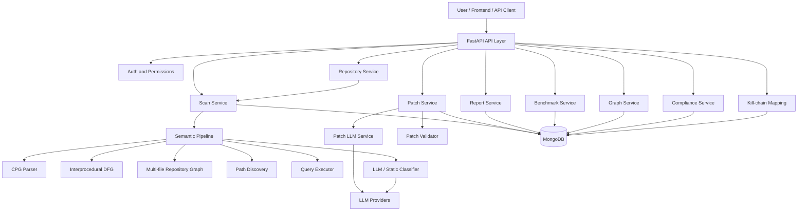

### Architecture Slide Prompt
Generate a modern system architecture slide with clear layers: API, Services, Semantic Engine, LLM, Persistence, Outputs.

## System Modules Overview

### Main Modules

1. Authentication and Authorization Module

   Handles registration, login, logout, JWT access/refresh tokens, role-aware authorization, OAuth flows, and password reset.

2. Repository Module

   Handles repository records, uploaded ZIP/TAR archives, repository URLs, branches, and scan scope selection.

3. Scan Module

   Creates scan records, launches asynchronous direct-code or repository scan workers, updates progress/logs, stores summaries, and persists graph data.

4. Semantic Engine Module

   Orchestrates graph building, path discovery, query execution, candidate slicing, LLM classification, deduplication, and vulnerability formatting.

5. Graph Construction Module

   Builds AST/CPG, DFG, call graph, taint graph, module graph, route graph, and HTML/backend linkage.

6. Query Rule Module

   Loads static vulnerability rules from `queries/queries.json`, including source/sink rules, regex rules, sanitizer checks, file-pattern checks, and guard-aware rules.

7. LLM Classification Module

   Validates candidate findings using structured prompts and multi-provider fallback. Falls back to static classification when LLMs are unavailable.

8. Patch Module

   Generates secure patches using an industrial CoT workflow, validates diffs, syntax, semantics, AST patterns, and adversarial attack resistance.

9. Reporting Module

   Generates scan reports, lists completed scans, merges patch status into findings, and exports PDF/CSV/JSON.

10. Benchmark Module

   Runs synthetic and field benchmarks, computing precision, recall, F1, false-positive rate, per-CWE metrics, and duration.

11. Kill-chain Module

   Maps vulnerabilities to attacker progression stages and generates blast-radius scoring and attack-chain narratives.

12. Compliance Module

   Maps vulnerabilities to OWASP, PCI-DSS, and SOC2 controls and computes pass/warn/fail statuses.

13. Graphify Knowledge Graph Helper

   Builds project-level knowledge graphs and architecture reports in `graphify-out`, useful for understanding repository structure but separate from the vulnerability engine.

## Per-module Methodology and Detail

### 1. Authentication and Authorization Module

Purpose:
Secure access to scan, repository, report, patch, benchmark, and admin endpoints.

Methodology:

1. Users authenticate using credentials or OAuth.
2. Backend issues JWT access and refresh tokens.
3. Protected endpoints depend on token validation.
4. Role-aware permission checks control access to resources.
5. Admin users can access broader report and scan data.

Diagram:

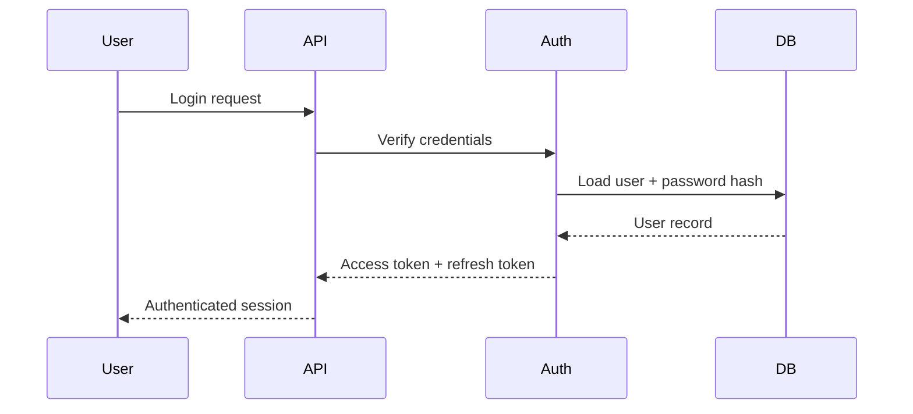

### 2. Repository Module

Purpose:
Prepare source code for scanning.

Methodology:

1. User uploads an archive or provides a repository URL.
2. Backend stores repository metadata.
3. Local archives are extracted to a temporary workspace.
4. Remote repositories are cloned into a temporary workspace.
5. Optional file path filters restrict scan scope.
6. Supported source files are recursively collected.

Diagram:

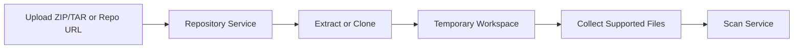

### 3. Scan Module

Purpose:
Control the scan lifecycle.

Methodology:

1. Create a scan document in MongoDB.
2. Identify input type as `DIRECT_CODE` or `REPOSITORY`.
3. Dispatch the correct asynchronous scan worker.
4. Update scan state, progress, logs, current file, file counts, and timestamps.
5. Call the semantic pipeline.
6. Store vulnerabilities, graph data, and summary.
7. Trigger optional confirmation/oracle task after completion.

Diagram:

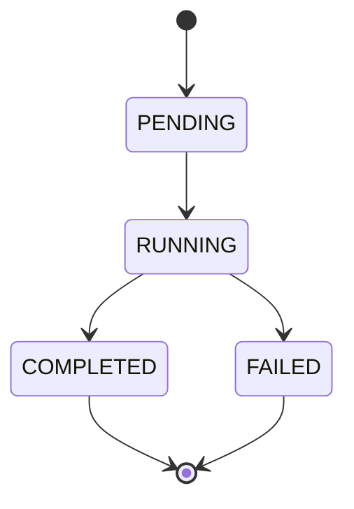

### 4. Semantic Engine Module

Purpose:
Perform end-to-end vulnerability detection.

Methodology:

1. Build graph from source code or repository.
2. Run broad path discovery.
3. Execute static query rules.
4. Extract candidate code slices.
5. Classify slices using LLM or static fallback.
6. Deduplicate and rank findings.
7. Format vulnerabilities with evidence, severity, confidence, CWE, OWASP, source, sink, and remediation.

Diagram:

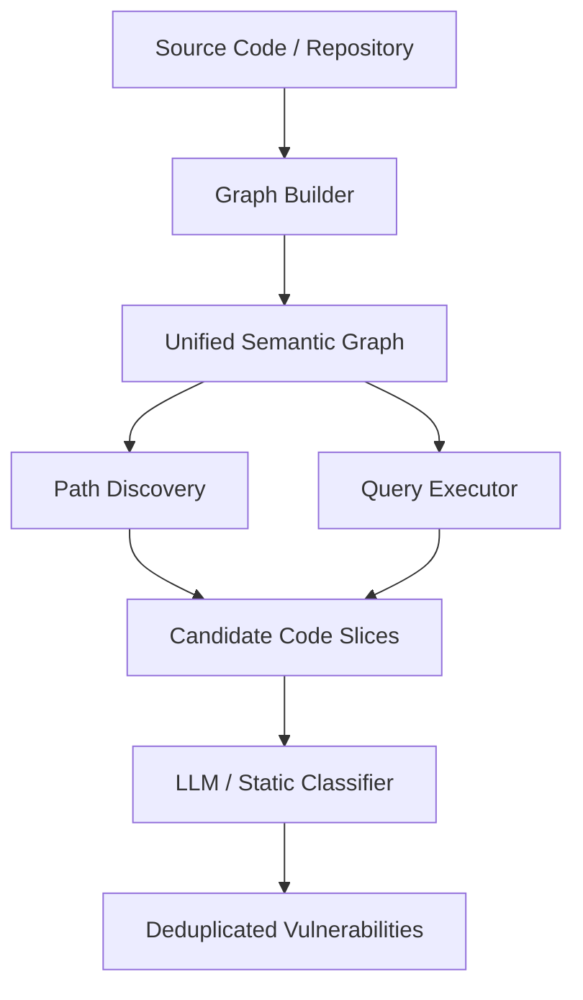

### 5. Graph Construction Module

Purpose:
Convert code into a rich graph representation.

Methodology:

1. Tree-sitter parses code into syntax trees.
2. CPG parser creates typed graph nodes and AST edges.
3. Interprocedural DFG adds variable, parameter, return, callback, closure, and interpolation flows.
4. Call graph links callers to callees.
5. Repository graph resolves imports, exports, re-exports, and cross-file links.
6. HTML/template parser links frontend/template flows to backend handlers.
7. Route/auth linker connects endpoints to handlers and guards.

Graph types included in the unified graph:

1. AST graph.
2. Control-flow graph.
3. Data-flow graph.
4. Call graph.
5. Module graph.
6. Taint graph.
7. Auth/permission graph.
8. HTTP/API graph.
9. Database graph.

Diagram:

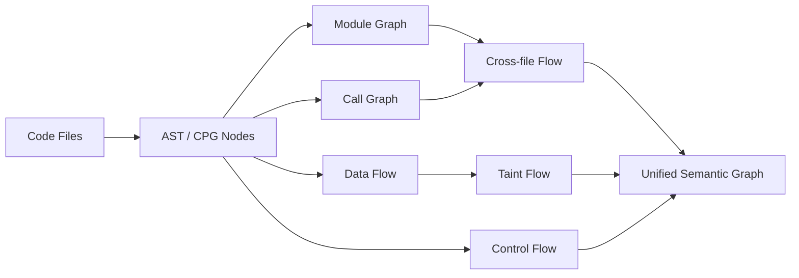

### 6. Query Rule Module

Purpose:
Find vulnerability evidence in the graph and raw code.

Methodology:

1. Load rules from `queries/queries.json`.
2. Resolve source nodes from rule source patterns.
3. Resolve sink nodes from rule sink patterns.
4. Traverse graph paths such as `DFG_FLOW` and `TAINT_FLOW`.
5. Apply sanitizer and guard-aware filtering.
6. Execute regex checks for configuration, dependency, and dangerous API rules.
7. Extract minimal code snippets and source-to-sink evidence.

Diagram:

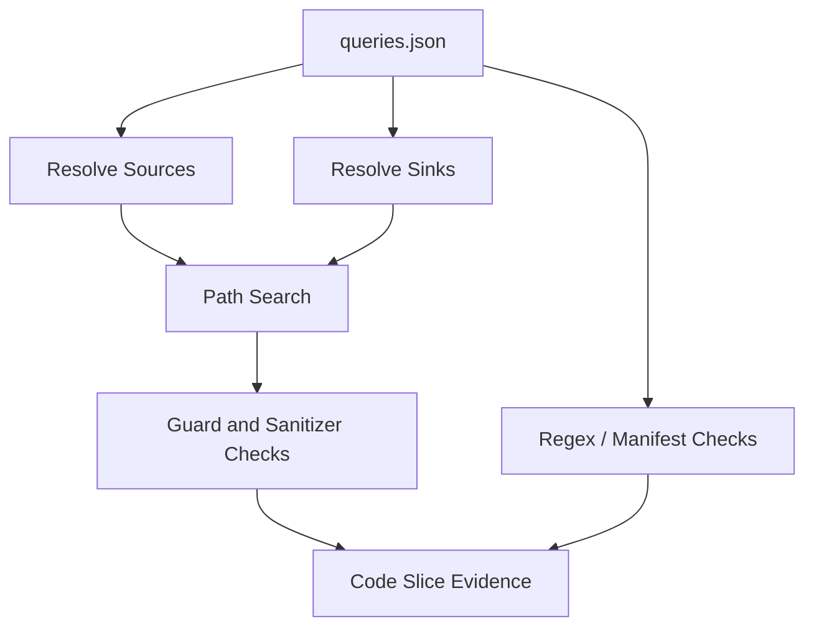

### 7. LLM Classification Module

Purpose:
Reduce false positives and validate exploitability.

Methodology:

1. Candidate code slices are sorted by severity and confidence.
2. Presence-based rules can bypass LLM validation.
3. Remaining slices are sent to LLM workers.
4. Prompt includes code, source, sink, rule, OWASP, and CWE.
5. LLM returns structured JSON with vulnerability verdict, severity, explanation, and recommendation.
6. Parser normalizes LLM response.
7. Static fallback is used when LLMs are unavailable, exhausted, rate-limited, or invalid.
8. Final confidence and severity combine static and LLM signals.

Diagram:

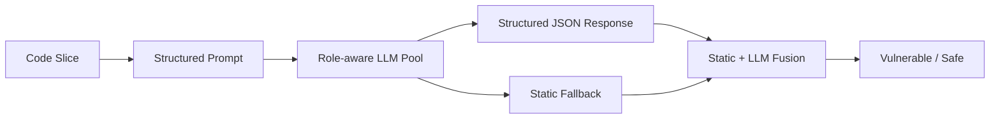

### 8. Patch Module

Purpose:
Generate and validate secure fixes.

Methodology:

1. Load vulnerability context.
2. Enforce rate limits, slice length limits, and secret rejection.
3. Build industrial chain-of-thought patch prompt.
4. Run four-phase reasoning: threat modeling, fix design, adversarial self-verification, formal patch specification.
5. Generate unified diff.
6. Validate diff format, syntax, diff application, semantic fix, and Python AST rules.
7. Retry with critique prompts if validation fails.
8. Run adversarial attack simulation against the patch.
9. Store patch, confidence, validations, attack test, status, version, and review state.
10. Sync patch status back into scan summary.

Patch CoT phases:

1. Threat modeling.
2. Fix design.
3. Adversarial self-verification.
4. Formal patch specification.

Patch validation steps:

1. Unified diff format check.
2. Target file match check.
3. Syntax validation.
4. Diff application validation.
5. Vulnerability-specific semantic validation.
6. Python AST validation.
7. Confidence score calculation.
8. Adversarial attack simulation.

Diagram:

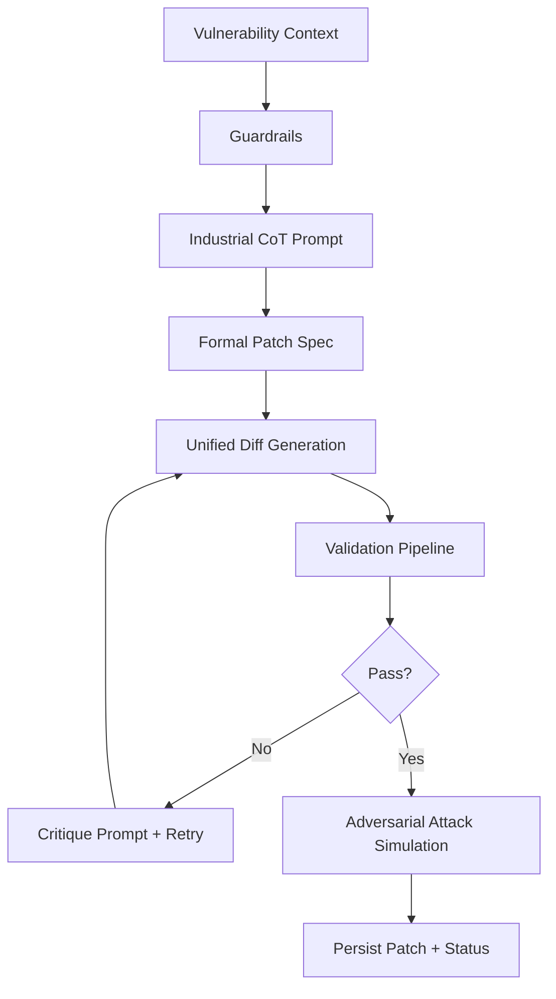

### 9. Benchmark Module

Purpose:
Measure scanner performance.

Methodology:

1. Load synthetic benchmark cases from MongoDB.
2. Run the semantic pipeline on each case.
3. Compare detected result against label.
4. Classify outcome as TP, FP, FN, or TN.
5. Compute precision, recall, F1 score, false-positive rate, duration, and per-CWE metrics.
6. For field benchmarks, use oracle-confirmed real findings to estimate field precision.

Diagram:

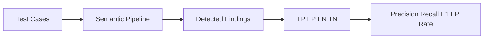

### 10. Kill-chain Module

Purpose:
Translate vulnerabilities into attacker progression.

Methodology:

1. Load completed scan vulnerabilities.
2. Map vulnerability type keywords to ATT&CK-style stages.
3. Group findings by stage.
4. Compute risk per stage.
5. Build edges between active stages.
6. Calculate blast-radius score.
7. Match active stages to chain templates such as full application takeover or injection-to-data-breach.
8. Generate narrative explaining likely attacker path.

Kill-chain stages:

1. Reconnaissance.
2. Initial Access.
3. Execution.
4. Persistence.
5. Privilege Escalation.
6. Credential Access.
7. Exfiltration.
8. Impact.

Diagram:

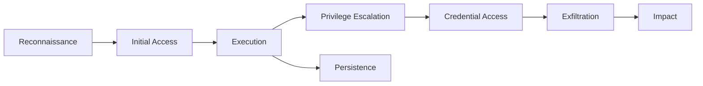

### 11. Compliance Module

Purpose:
Convert findings into governance and audit evidence.

Methodology:

1. Extract OWASP category from each vulnerability.
2. Map OWASP category to PCI-DSS and SOC2 control dictionaries.
3. Attach findings to relevant controls.
4. Assign PASS, WARN, or FAIL status.
5. Mark high/critical findings as failures.
6. Compute compliance score.
7. Return structured compliance data or PDF output.

Frameworks:

1. OWASP Top 10 2021.
2. PCI-DSS 4.0.
3. SOC2 Trust Service Criteria.

Diagram:

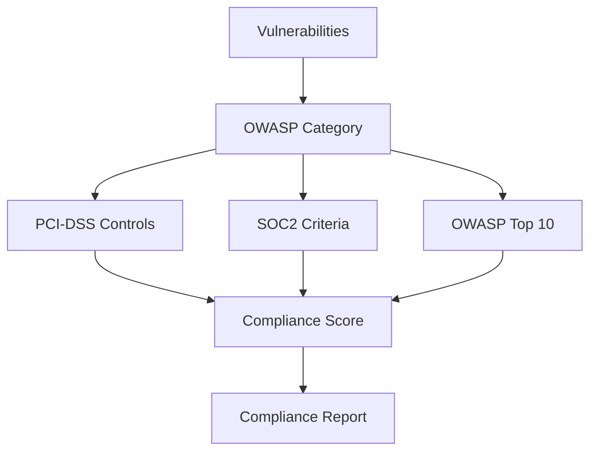

### 12. Reporting Module

Purpose:
Create human-readable and exportable scan results.

Methodology:

1. Retrieve completed scan summary.
2. Merge patch status into each vulnerability.
3. Build severity summary.
4. Include file, line, vulnerability type, CWE, OWASP, source, sink, evidence, explanation, and recommendation.
5. Export PDF, CSV, or JSON.
6. Enforce access control so users only see permitted reports.

Diagram:

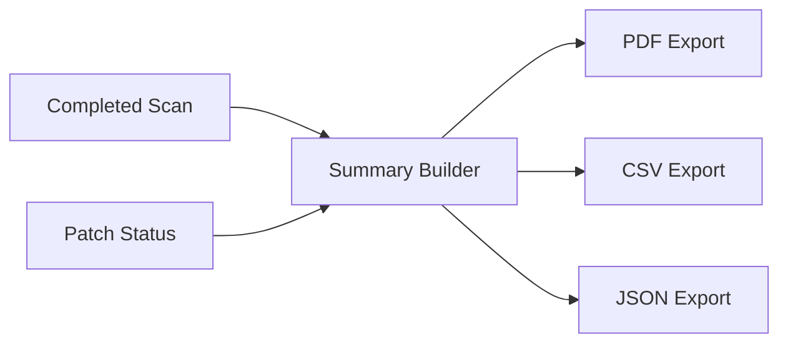

## End-to-end Pipelines

### Pipeline 1: Direct Code Scan

1. User submits code, filename, and language.
2. Scan service creates a scan record.
3. Async direct-code worker starts.
4. Semantic pipeline builds a single-file graph.
5. Path discovery finds candidate source-to-sink paths.
6. Query executor applies static rules.
7. Candidate code slices are extracted.
8. Classifier validates exploitability.
9. Findings are deduplicated and formatted.
10. Scan summary and graph data are stored.
11. User retrieves status, logs, graph, and report.

Diagram:

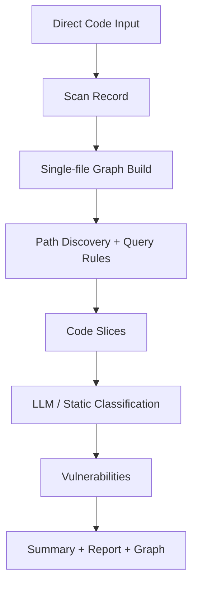

### Pipeline 2: Repository Scan

1. User uploads archive or submits repository URL.
2. Repository is extracted or cloned.
3. Supported files are collected.
4. Per-file CPGs are built in parallel.
5. Global symbol table is created.
6. Imports, exports, and re-exports are resolved.
7. Cross-file DFG and call-graph edges are added.
8. HTML/templates are linked to backend routes.
9. Global repository graph is created.
10. Path discovery and query execution run across the graph.
11. LLM/static classification validates findings.
12. Deduplicated vulnerabilities are stored with repo-relative paths.
13. Per-file and global graph data are saved for UI/reporting.

Diagram:

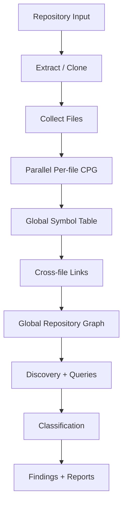

### Pipeline 3: Patch Generation and Validation

1. User selects a vulnerability.
2. Patch module loads vulnerability context.
3. Guardrails check rate limits, slice length, and secrets.
4. LLM performs industrial CoT patch reasoning.
5. LLM generates a unified diff.
6. Validation pipeline runs.
7. If validation fails, critique prompt triggers retry.
8. Best patch is selected by confidence.
9. Adversarial attack simulation runs.
10. Patch is stored and linked to scan summary.

### Pipeline 4: Benchmarking

1. Load benchmark cases.
2. Run semantic pipeline.
3. Compare detection result to label.
4. Record TP/FP/FN/TN.
5. Compute precision, recall, F1, false-positive rate, and per-CWE metrics.
6. Store benchmark run.

### Pipeline 5: Governance Output

1. Completed scan findings are loaded.
2. Kill-chain module maps findings to attacker stages.
3. Compliance module maps findings to OWASP, PCI-DSS, and SOC2 controls.
4. Report module exports technical and governance evidence.

## Comparative Analysis with Other Tools

### Comparison Criteria

Compare VULCAN with common security tools using these criteria:

1. Detection method.
2. Cross-file analysis.
3. Graph-based explainability.
4. LLM validation.
5. Automated patch generation.
6. Patch validation.
7. Kill-chain mapping.
8. Compliance mapping.
9. Benchmark support.
10. Developer actionability.

### Comparative Table

| Tool | Primary Method | Strengths | Limitations | VULCAN Difference |
|---|---|---|---|---|
| Semgrep | Pattern/rule-based static analysis | Fast, customizable, developer-friendly | Limited deep data-flow unless rules are advanced; patch generation is not core | VULCAN combines graph paths, LLM validation, patch generation, kill-chain, and compliance |
| CodeQL | Semantic code queries over code database | Powerful data-flow and query language | Requires query expertise; remediation workflow not central | VULCAN focuses on end-to-end scan-to-patch workflow with LLM validation |
| SonarQube | Static code quality and security analysis | Mature dashboards, quality gates, enterprise workflow | Security findings can still require manual triage and remediation | VULCAN adds source-to-sink graph evidence, LLM explainability, and patch validation |
| Snyk Code | AI-assisted SAST and dependency security | Strong developer integration and dependency focus | Proprietary black-box internals; patch reasoning details may be limited | VULCAN emphasizes transparent graph methodology and local research extensibility |
| Bandit | Python security linter | Lightweight and fast for Python | Single-language and mostly pattern-based | VULCAN supports repository-level graph analysis across Python/JS/TS/templates |
| ESLint Security Plugins | JavaScript linting rules | Easy JS integration | Rule/lint focused, limited cross-file security reasoning | VULCAN tracks cross-file source-to-sink flow and LLM-assisted validation |
| Traditional DAST | Runtime black-box testing | Finds exploitable runtime behavior | Needs running app and may miss code paths | VULCAN analyzes source before deployment and provides code-level remediation |

### Comparative Analysis Summary

VULCAN is not intended to replace all specialized commercial tools. Its unique value is the integrated research-oriented workflow:

1. It combines graph-based static analysis with LLM semantic validation.
2. It supports cross-file and repository-level vulnerability reasoning.
3. It produces explainable source-to-sink evidence.
4. It generates patches rather than only alerts.
5. It validates patches through syntax, diff, semantic, AST, and adversarial checks.
6. It maps technical findings to attacker kill chains and compliance frameworks.

### Comparative Analysis Slide Prompt
Create a slide with a matrix/table. Highlight VULCAN as "Integrated: Graph + LLM + Patch + Governance" while other tools usually specialize in one or two areas.

## Conclusion

VULCAN demonstrates a practical hybrid approach to modern vulnerability detection. Instead of relying only on regex signatures or isolated static rules, it builds semantic graphs that represent structure, control flow, data flow, calls, modules, routes, templates, and security-relevant paths.

The system turns raw source code into actionable security intelligence:

1. It accepts direct code and repository inputs.
2. It constructs unified semantic graphs.
3. It detects source-to-sink vulnerability paths.
4. It validates exploitability using LLM classification and static fallback.
5. It generates and validates secure patches.
6. It benchmarks scanner performance.
7. It maps findings to attacker kill chains.
8. It maps findings to compliance controls.
9. It exports reports for developers, reviewers, and administrators.

The project's key contribution is the complete scan-to-remediation methodology: detection, explanation, validation, patching, benchmarking, and governance are connected in one workflow.

### Current Limitations

1. Some framework-specific flow resolution remains heuristic.
2. Full production scaling and high-availability deployment are future work.
3. Field recall cannot be measured without labeled missed vulnerabilities.
4. LLM output still requires strict validation and fallback because model responses can fail or vary.
5. Enterprise triage workflows and full frontend analytics are future enhancements.

### Future Work

1. Add queue-based scan orchestration for concurrent large repositories.
2. Expand framework-specific analysis for Django, Flask, FastAPI, Express, React, and Next.js.
3. Improve rule tuning using accepted/rejected finding feedback.
4. Add pull-request integrations for GitHub/GitLab/Bitbucket.
5. Add richer frontend graph exploration and remediation review.
6. Add full observability with metrics, tracing, structured logs, and alerts.
7. Add organization-specific compliance policy plugins.
8. Improve patch quality scoring with regression test execution.

### Final Slide Message
VULCAN moves vulnerability scanning from "finding suspicious lines" toward "understanding vulnerable flows, validating real risk, and producing safer code."

## Suggested Slide Deck Outline

1. Title Slide
2. Motivation / Problem
3. Problem Statement
4. Project Scope and Scale
5. High-level Architecture
6. System Modules Overview
7. Input and Scan Lifecycle
8. Semantic Graph Construction
9. Graph Types: AST, CFG, DFG, Call, Taint, Module
10. Repository and Cross-file Analysis
11. Query Execution and Path Discovery
12. LLM Classification Layer
13. Patch Generation Methodology
14. Patch Validation Methodology
15. Benchmarking Methodology
16. Kill-chain Mapping
17. Compliance Mapping
18. Reporting Outputs
19. End-to-end Pipeline
20. Comparative Analysis
21. Limitations and Future Work
22. Conclusion

## Short Speaker Notes

### Opening
VULCAN is an intelligent vulnerability analysis platform that combines static graph analysis with LLM-assisted validation and remediation. The goal is not only to detect vulnerabilities, but to explain how data flows into dangerous sinks and help developers fix the issue safely.

### Problem
Modern vulnerabilities are flow-based and cross-file. A user input may start in a route handler, pass through services, templates, or helper functions, and finally reach a database query or shell command. Pattern matching alone cannot reliably explain that path.

### Solution
VULCAN builds a semantic graph of the codebase, searches source-to-sink paths, validates findings with an LLM, and then generates patches with multiple validation gates.

### Contribution
The main contribution is an end-to-end security workflow: graph construction, detection, classification, patch generation, validation, benchmarking, kill-chain mapping, compliance mapping, and reporting.

